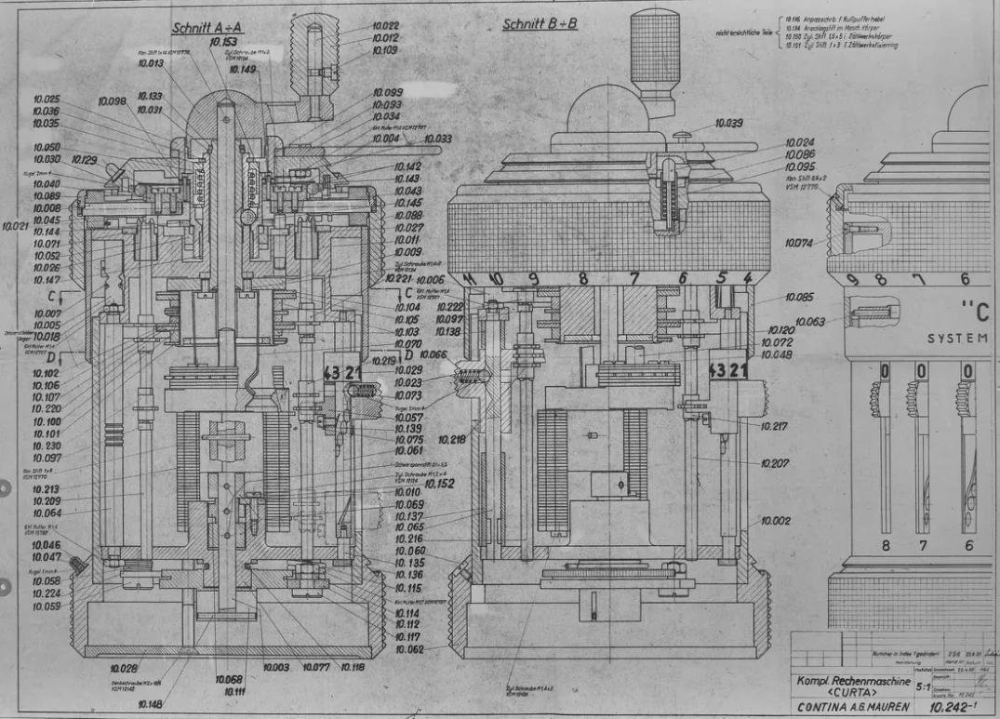
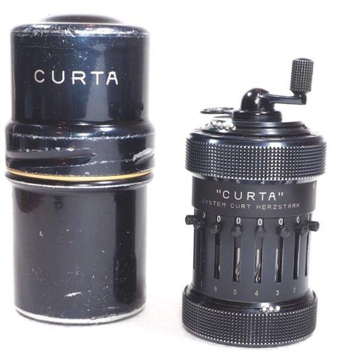
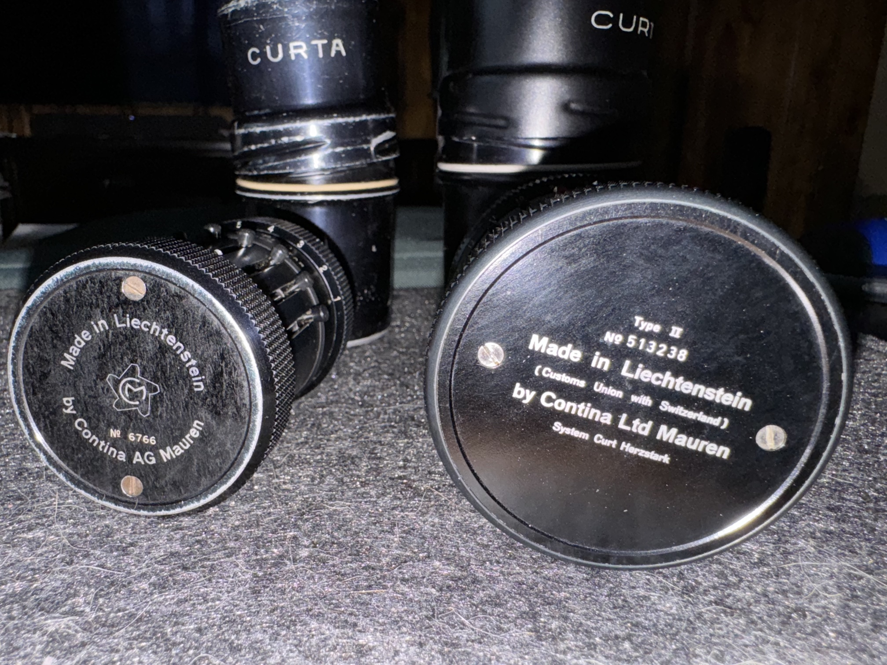
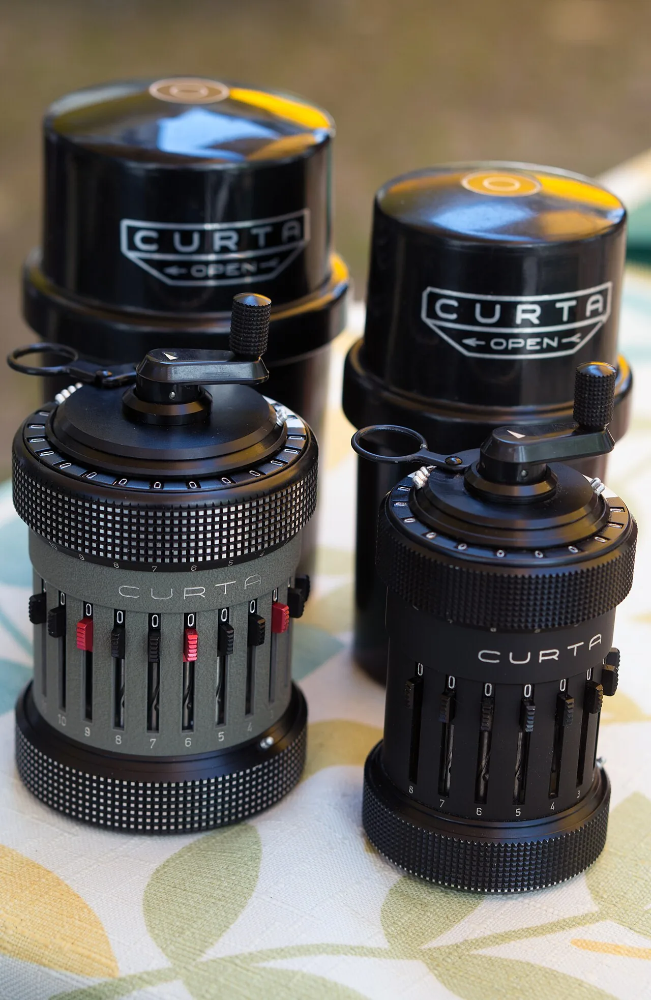
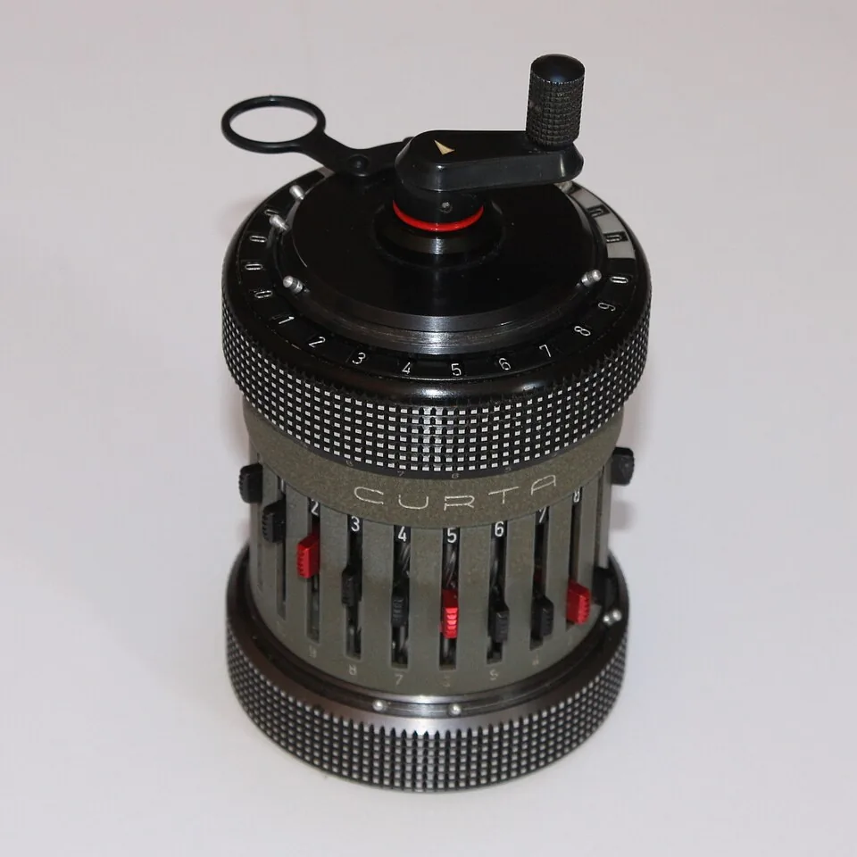
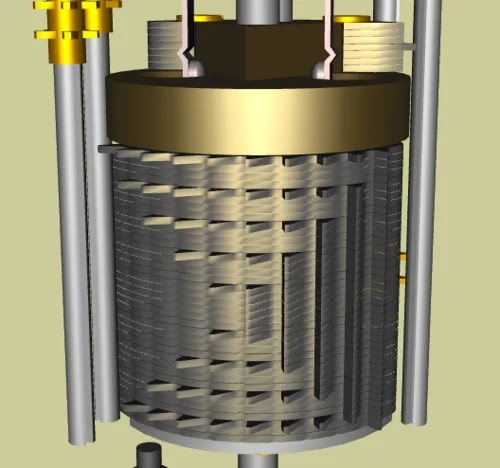
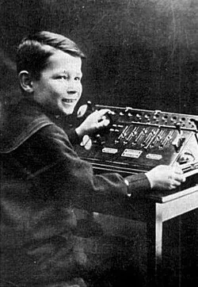

# Pepper Mill gallery

Pictures and drawings of the **Curta**, the hand-cranked pocket calculator Curt Herzstark designed and
Contina AG built in Mauren, Liechtenstein, from 1948 to the early 1970s. Collected for
[Pepper Mill: Curta Calculator](#about), an iPhone calculator whose answers are worked out by an
animated Curta. Everything here may be reused under the terms given with it.

## The factory drawings

All 257 sheets of the Type I drawing set, as one bookmarked PDF and as single sheets:
**[drawings/](drawings/)**. Public domain (Contina AG); scans and translations by Chris Hurt,
[curta-drawings](https://github.com/cshurt64/curta-drawings) (CC BY 4.0, please credit him).

*Sheet 10.242-1, the complete machine in section: the stepped drum, the setting shafts, the
carriage with its counting wheels, and the crank on top.*

## Our Curtas

The two machines the app is modelled on: a Type I, Nº 6766 (an early "pin slider", about
1950), and a Type II, Nº 513238.

Photos of our own machines; you may reuse them with a credit to "Pepper Mill".

## Curta photos from Wikimedia Commons

66 freely licensed photographs and diagrams of Type I and Type II Curtas, in museums and in
hand, and drawings of the mechanism inside: **[photos/commons/](photos/commons/)**. Each keeps its own
license (CC0, public domain, CC BY or CC BY-SA); the author, license and Commons page are given
under every picture and in [credits.json](photos/commons/credits.json).

*A Type II and a Type I side by side. Photo: Werner Kratz,
[CC BY 2.0](https://creativecommons.org/licenses/by/2.0), via
[Wikimedia Commons](https://commons.wikimedia.org/wiki/File:Type_II_and_Type_I_Curta_(9064000240).jpg).*

*Type II with the crank pulled up to subtract. Photo: Nol Aders,
[CC BY-SA 3.0](https://creativecommons.org/licenses/by-sa/3.0), via
[Wikimedia Commons](https://commons.wikimedia.org/wiki/File:Curta-95.jpg).*

*The stepped drum's two sets of teeth, for adding and for subtracting by nines complement. Drawing:
Manuco, [CC0](https://creativecommons.org/publicdomain/zero/1.0/), via
[Wikimedia Commons](https://commons.wikimedia.org/wiki/File:Stepped_drum.png).*

*Curt Herzstark, aged 8, demonstrating one of his father's calculating machines at an
office-equipment show in Vienna, 1910. Photographer unknown, public domain (PD-Austria), via
[Wikimedia Commons](https://commons.wikimedia.org/wiki/File:Curt-1910-6a.jpg).*

## More about the Curta

- [curta.org](https://curta.org): the Curta community, with history, manuals, serial numbers and a forum
- [The Calculator Reference](https://www.vcalc.net/cu.htm): Rick Furr's Curta pages, including his exploded parts poster of the Type I
- [Jaap's Mechanical Calculators](https://www.jaapsch.net/mechcalc/curta.htm): how it works, with photos
- [Wikipedia: Curta](https://en.wikipedia.org/wiki/Curta) and the [Curta photos on Wikimedia Commons](https://commons.wikimedia.org/wiki/Category:Curta_calculator)
- [ReCurta](https://github.com/daeken/ReCurta): public-domain 3D models of the Type I's parts
- In museums: the [Smithsonian](https://www.si.edu/object/curta-type-i-calculating-machine:nmah_690690) and the [Computer History Museum](https://www.computerhistory.org/collections/catalog/102618878)

Other people's photos that are not freely licensed are linked to where they live rather than
copied here; please ask their owners before reusing them.

## About

Pepper Mill shows the Curta doing the arithmetic: set the sliders, shift the carriage, turn the
crank, read the dials. Its 3D model is built from ReCurta's parts placed by Contina's own
drawings.
