# Curta photos from Wikimedia Commons

66 freely licensed photographs and diagrams of the Curta, from Wikimedia Commons'
[Category:Curta calculator](https://commons.wikimedia.org/wiki/Category:Curta_calculator) and its
subcategories, downsized (at most 1280 px wide) and saved as WebP. **Each one keeps its own license**:
reuse it under that license, crediting the author named here and linking the Commons page.
Where the license is CC BY-SA, a changed version must be shared under the same license.
The same credits are in [credits.json](credits.json).

## Type I

[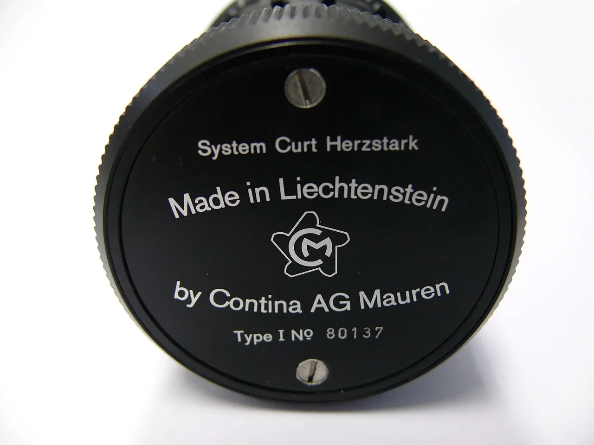](2010-curta-calculator-03.webp)

CURTA Type I Calculator, mechanical calculator. Photo: Thomas Schanz, [CC BY-SA 3.0](https://creativecommons.org/licenses/by-sa/3.0), via [Wikimedia Commons](https://commons.wikimedia.org/wiki/File:2010_CURTA_Calculator_03.jpg).

[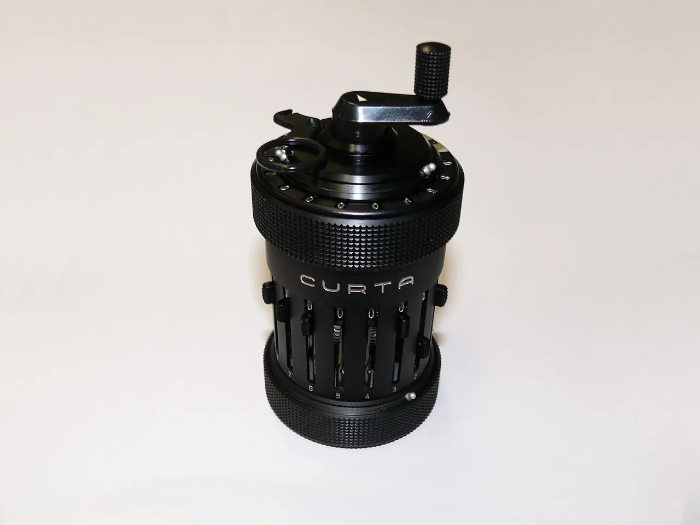](2010-curta-calculator-02.webp)

CURTA Type I Calculator, mechanical calculator. Photo: Thomas Schanz, [CC BY-SA 3.0](https://creativecommons.org/licenses/by-sa/3.0), via [Wikimedia Commons](https://commons.wikimedia.org/wiki/File:2010_CURTA-Calculator_02.jpg).

[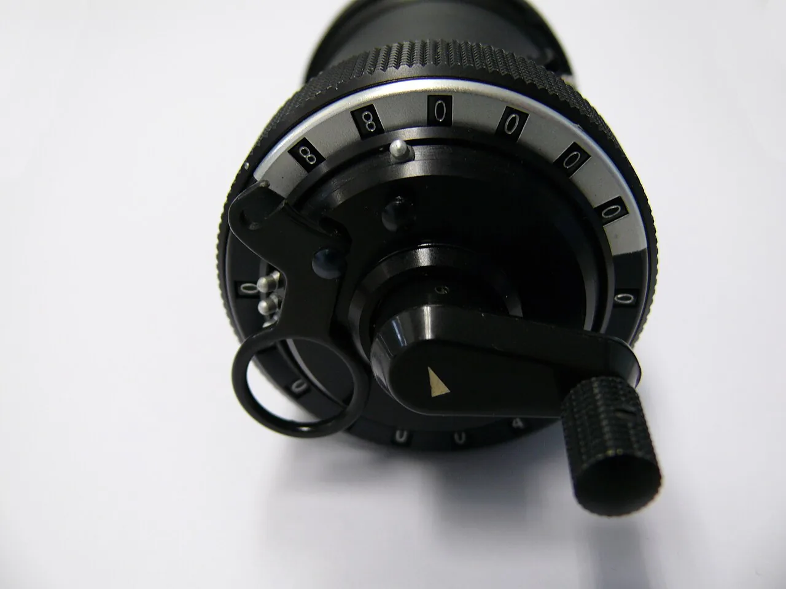](2010-curta-calculator-05.webp)

CURTA Type I Calculator, mechanical calculator. Photo: Thomas Schanz, [CC BY-SA 3.0](https://creativecommons.org/licenses/by-sa/3.0), via [Wikimedia Commons](https://commons.wikimedia.org/wiki/File:2010_CURTA-Calculator_05.jpg).

[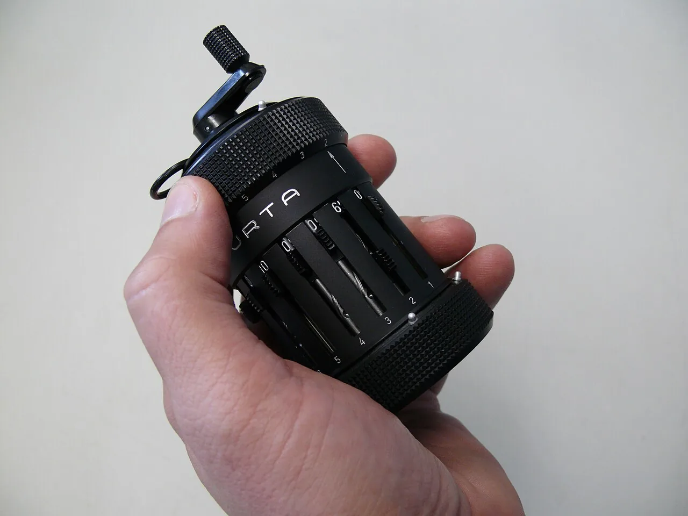](2010-curta-calculator-08.webp)

CURTA Type I Calculator, mechanical calculator. Photo: Thomas Schanz, [CC BY-SA 3.0](https://creativecommons.org/licenses/by-sa/3.0), via [Wikimedia Commons](https://commons.wikimedia.org/wiki/File:2010_CURTA-Calculator_08.jpg).

[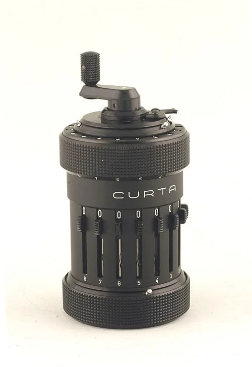](milan-museoscienza-09527-01.webp)

Curta Type I; Museo Nazionale Scienza e Tecnologia Leonardo da Vinci, Milan. Photo: Museo Nazionale Scienza e Tecnologia Leonardo da Vinci, [CC BY-SA 4.0](https://creativecommons.org/licenses/by-sa/4.0), via [Wikimedia Commons](https://commons.wikimedia.org/wiki/File:Calcolatrice_meccanica_-_Museo_scienza_tecnologia_Milano_09527_01.jpg).

Curta Type I; Museo Nazionale Scienza e Tecnologia Leonardo da Vinci, Milan. Photo: Museo Nazionale Scienza e Tecnologia Leonardo da Vinci, [CC BY-SA 4.0](https://creativecommons.org/licenses/by-sa/4.0), via [Wikimedia Commons](https://commons.wikimedia.org/wiki/File:Calcolatrice_meccanica_-_Museo_scienza_tecnologia_Milano_09527.jpg).

[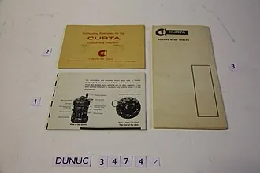](curta-calculating-machine.webp)

A Curta with its instruction leaflet, computing examples and square-root tables; University of Dundee Museum Services. Photo: University of Dundee Museum Services, [CC BY-SA 4.0](https://creativecommons.org/licenses/by-sa/4.0), via [Wikimedia Commons](https://commons.wikimedia.org/wiki/File:Curta_Calculating_Machine.jpg).

[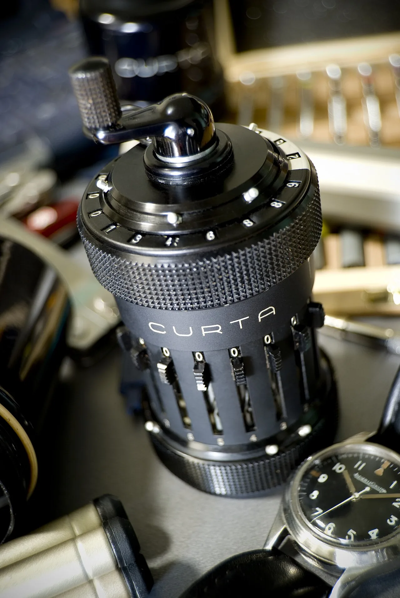](curta-calculator-7419454394.webp)

A Curta Type I. Photo: Francis Chang, [CC BY-SA 2.0](https://creativecommons.org/licenses/by-sa/2.0), via [Wikimedia Commons](https://commons.wikimedia.org/wiki/File:Curta_Calculator_(7419454394).jpg).

[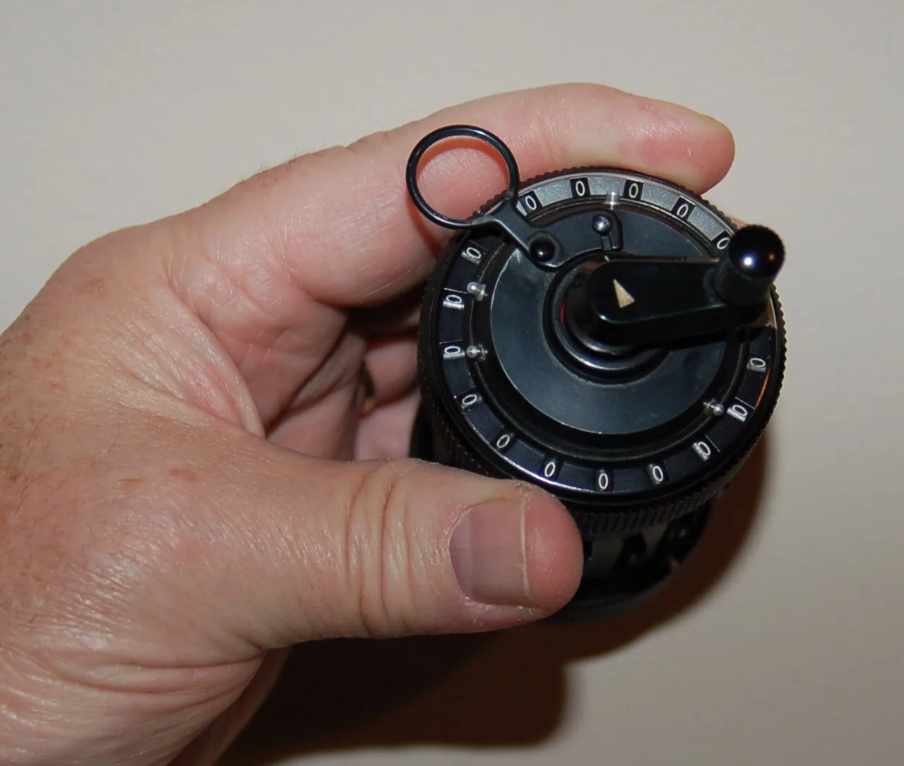](curta-calculator.webp)

Curta Type I Nº 49465 in the hand. Photo: Larry McElhiney, [CC BY-SA 2.5](https://creativecommons.org/licenses/by-sa/2.5), via [Wikimedia Commons](https://commons.wikimedia.org/wiki/File:Curta_calculator.jpg).

[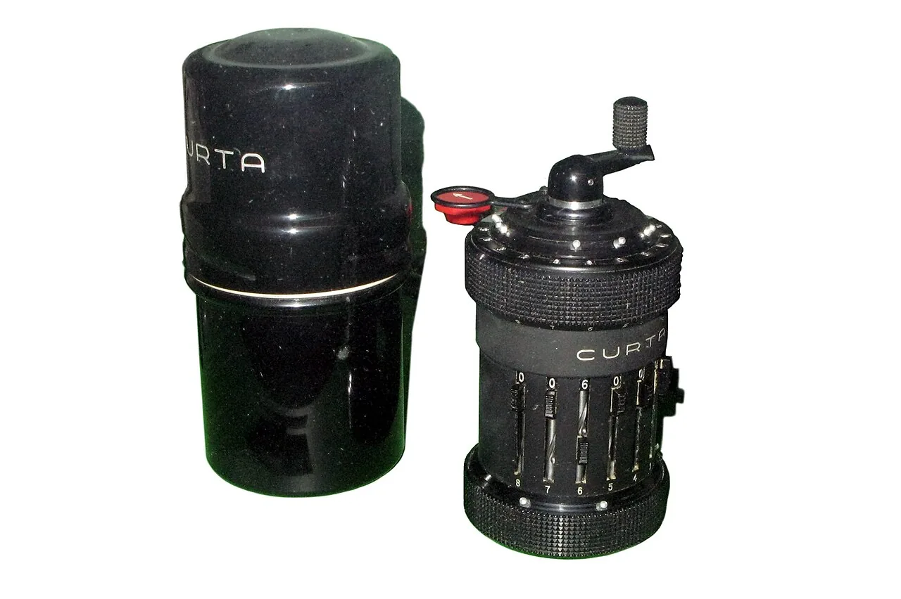](curta-mechanical-computer-img-1650.webp)

Curta Type I. Photo: Rama, [CC BY-SA 2.0 fr](https://creativecommons.org/licenses/by-sa/2.0/fr/deed.en), via [Wikimedia Commons](https://commons.wikimedia.org/wiki/File:Curta_Mechanical_computer_img_1650.jpg).

[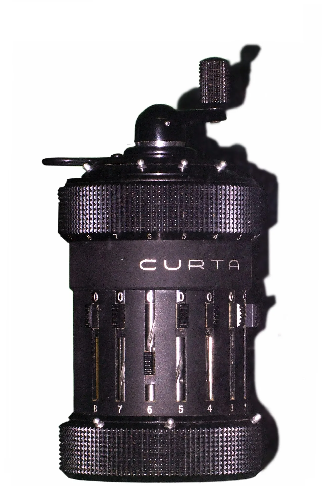](curta-mechanical-computer-img-1651.webp)

Curta Type I. Photo: Rama, [CC BY-SA 2.0 fr](https://creativecommons.org/licenses/by-sa/2.0/fr/deed.en), via [Wikimedia Commons](https://commons.wikimedia.org/wiki/File:Curta_Mechanical_computer_img_1651.jpg).

[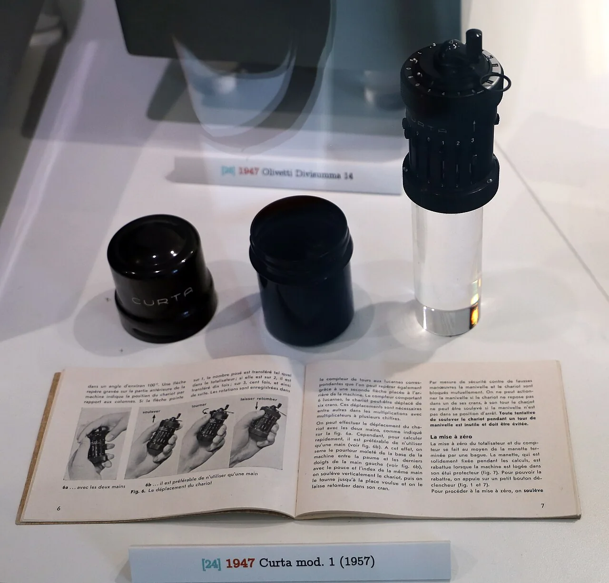](curta-mod-1-macchinetta-calcolatrice-tascabile-a-tamburo-194.webp)

Curta Type I (model 1, 1947 design, made 1957); Museo degli strumenti per il calcolo, Pisa. Photo: Sailko, [CC BY 3.0](https://creativecommons.org/licenses/by/3.0), via [Wikimedia Commons](https://commons.wikimedia.org/wiki/File:Curta_mod._1,_macchinetta_calcolatrice_tascabile_a_tamburo,_1947_(1957).jpg).

[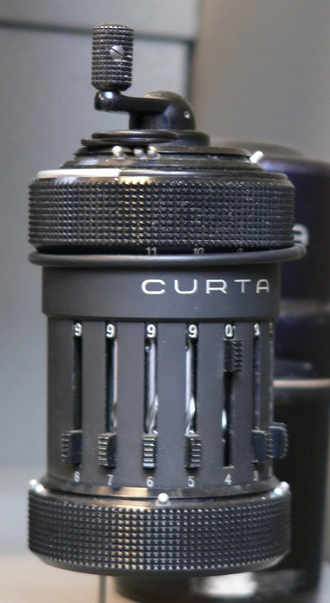](curta-p1040272.webp)

Curta Type I; Musée des Arts et Métiers, Paris. Photo: David Monniaux, [CC BY-SA 3.0](http://creativecommons.org/licenses/by-sa/3.0/), via [Wikimedia Commons](https://commons.wikimedia.org/wiki/File:Curta_p1040272.jpg).

[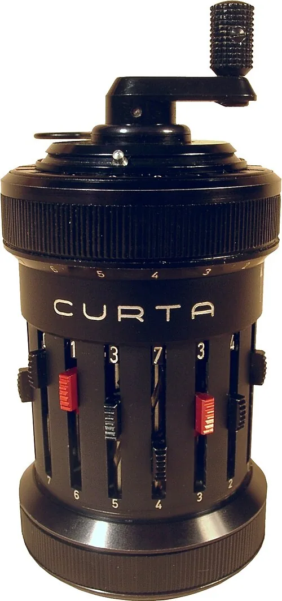](curta-typ-1a.webp)

A Curta "Type 1a", about 1968, made in Liechtenstein and never sold; Beck typewriter museum, Pfäffikon ZH. Photo: Mägi Beck, [CC BY-SA 3.0](https://creativecommons.org/licenses/by-sa/3.0), via [Wikimedia Commons](https://commons.wikimedia.org/wiki/File:Curta_Typ_1a.jpg).

[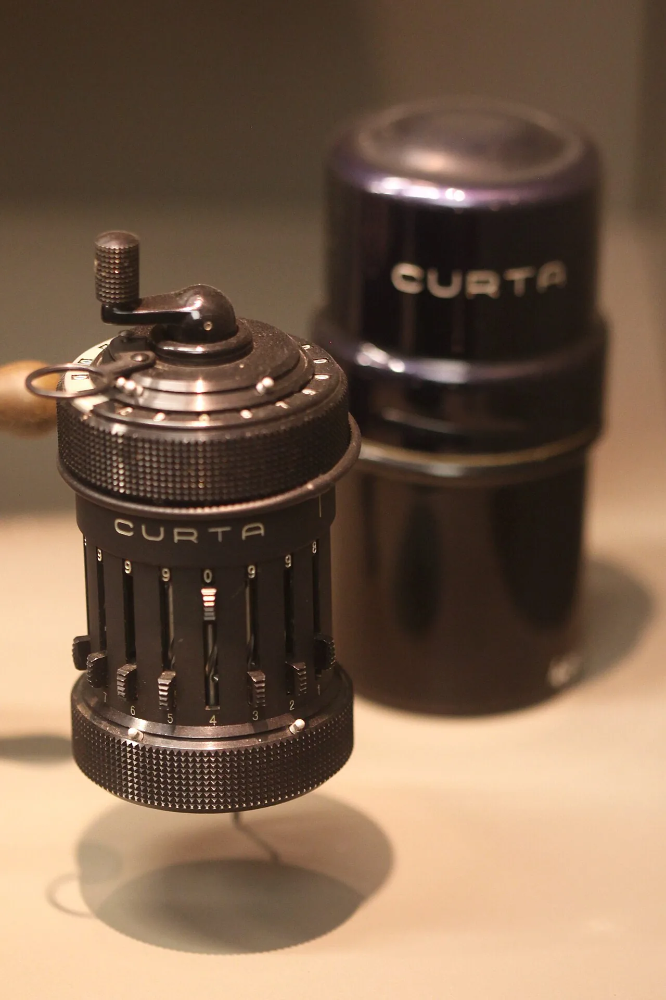](curta-type-i-cnam-40092-img-6716.webp)

Curta Type I; Musée des Arts et Métiers, Paris (CnAM 40092). Photo: Rama, [CC BY-SA 3.0 fr](https://creativecommons.org/licenses/by-sa/3.0/fr/deed.en), via [Wikimedia Commons](https://commons.wikimedia.org/wiki/File:Curta_type_I-CnAM_40092-IMG_6716.JPG).

[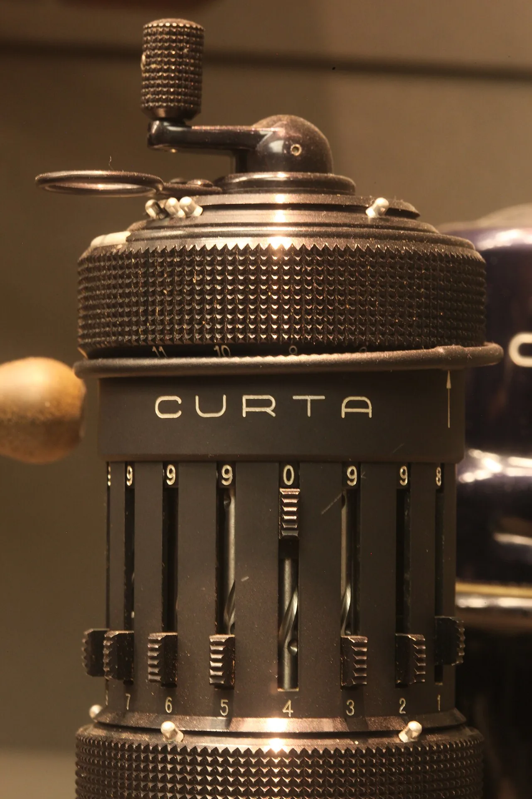](curta-type-i-cnam-40092-img-6718.webp)

Curta Type I; Musée des Arts et Métiers, Paris (CnAM 40092). Photo: Rama, [CC BY-SA 3.0 fr](https://creativecommons.org/licenses/by-sa/3.0/fr/deed.en), via [Wikimedia Commons](https://commons.wikimedia.org/wiki/File:Curta_type_I-CnAM_40092-IMG_6718.JPG).

[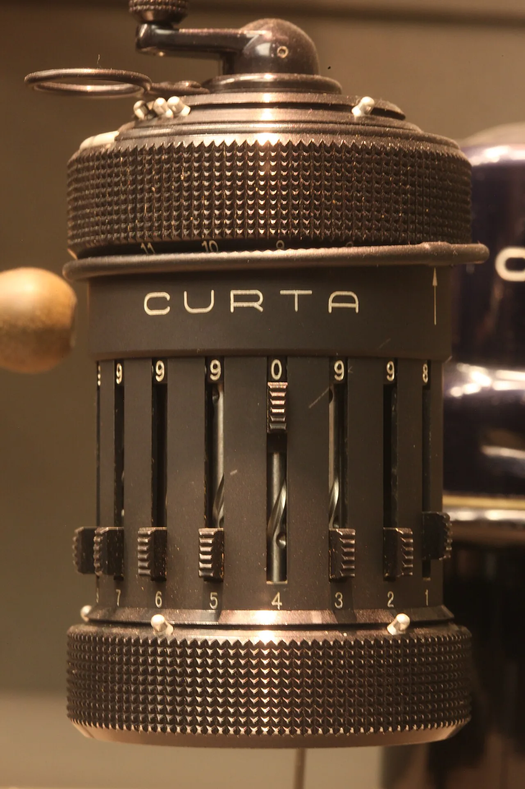](curta-type-i-cnam-40092-img-6720.webp)

Curta Type I; Musée des Arts et Métiers, Paris (CnAM 40092). Photo: Rama, [CC BY-SA 3.0 fr](https://creativecommons.org/licenses/by-sa/3.0/fr/deed.en), via [Wikimedia Commons](https://commons.wikimedia.org/wiki/File:Curta_type_I-CnAM_40092-IMG_6720.JPG).

[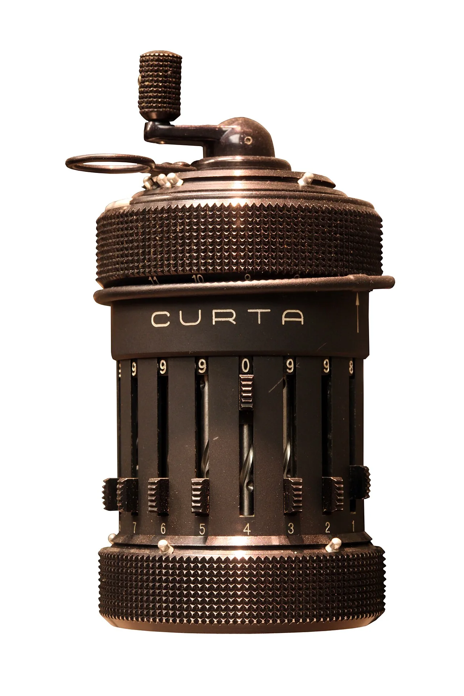](curta-type-i-cnam-40092-img-6721-white.webp)

Curta Type I; Musée des Arts et Métiers, Paris (CnAM 40092). Photo: Rama, [CC BY-SA 3.0 fr](https://creativecommons.org/licenses/by-sa/3.0/fr/deed.en), via [Wikimedia Commons](https://commons.wikimedia.org/wiki/File:Curta_type_I-CnAM_40092-IMG_6721-white.jpg).

Curta Type I Nº 49465, bought for $10 in Santa Cruz, California. Photo: Larry McElhiney, [CC BY-SA 2.5](https://creativecommons.org/licenses/by-sa/2.5), via [Wikimedia Commons](https://commons.wikimedia.org/wiki/File:Curta01.JPG).

[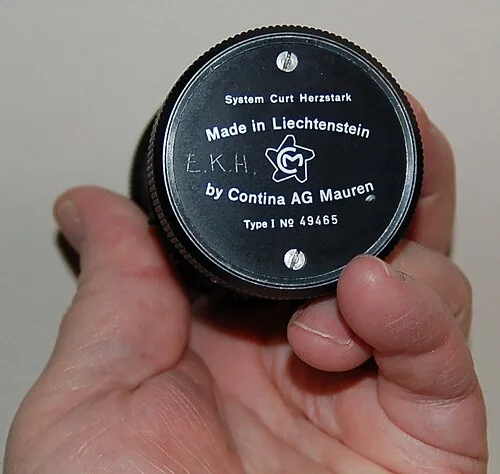](curta03.webp)

The bottom of Curta Type I Nº 49465. Photo: Larry McElhiney, [CC BY-SA 2.5](https://creativecommons.org/licenses/by-sa/2.5), via [Wikimedia Commons](https://commons.wikimedia.org/wiki/File:Curta03.JPG).

## Type II

[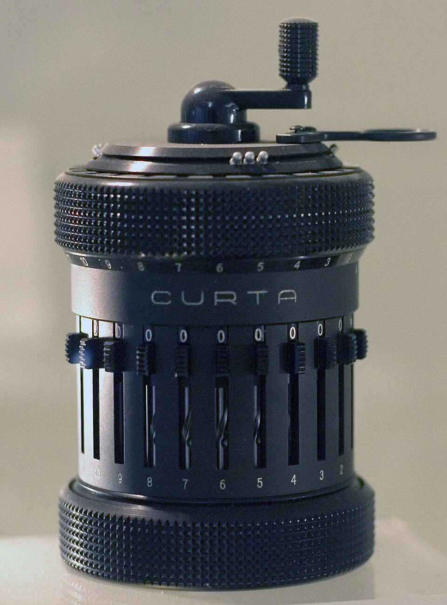](curta-national-museum-of-computing.webp)

Curta Type II at the National Museum of Computing, Bletchley Park. Photo: Prioryman, [CC BY-SA 4.0](https://creativecommons.org/licenses/by-sa/4.0), via [Wikimedia Commons](https://commons.wikimedia.org/wiki/File:Curta_-_National_Museum_of_Computing.jpg).

[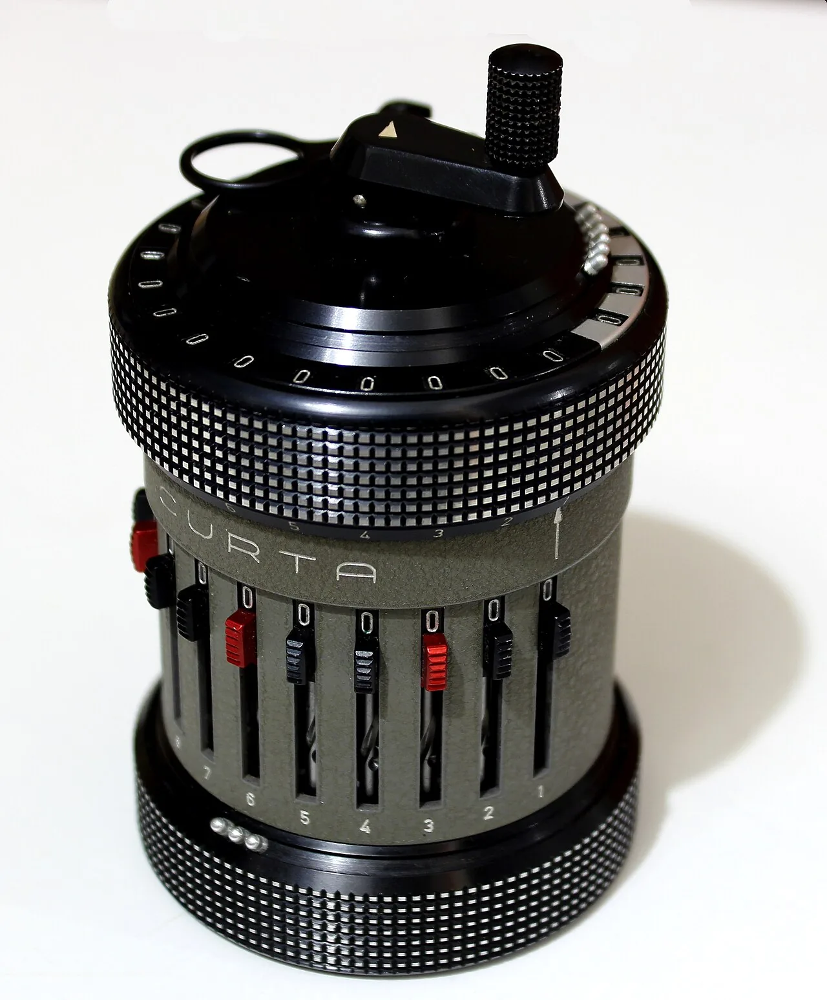](curta-ii-mechanical-calculator.webp)

Curta Type II. Photo: Oldsoft, [CC BY-SA 4.0](https://creativecommons.org/licenses/by-sa/4.0), via [Wikimedia Commons](https://commons.wikimedia.org/wiki/File:Curta_II_Mechanical_Calculator.JPG).

[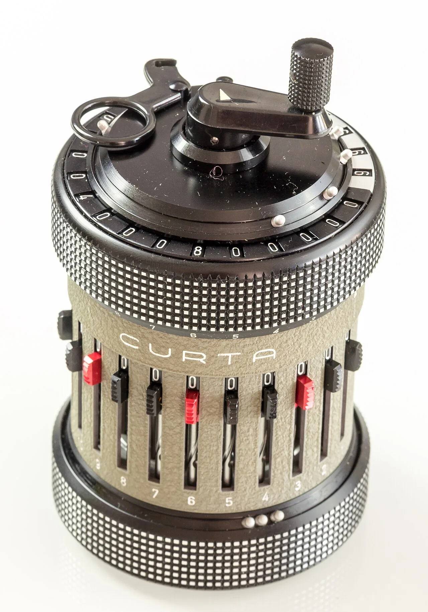](curta-ii-1119.webp)

Curta II. Photo: Raimond Spekking, [CC BY-SA 4.0](https://creativecommons.org/licenses/by-sa/4.0), via [Wikimedia Commons](https://commons.wikimedia.org/wiki/File:Curta_II-1119.jpg).

[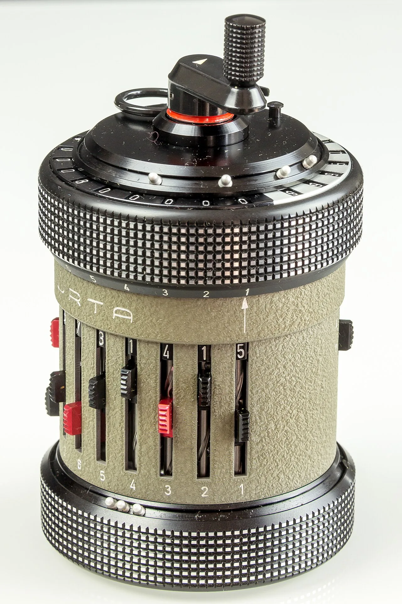](curta-ii-1124.webp)

Curta II. Photo: Raimond Spekking, [CC BY-SA 4.0](https://creativecommons.org/licenses/by-sa/4.0), via [Wikimedia Commons](https://commons.wikimedia.org/wiki/File:Curta_II-1124.jpg).

[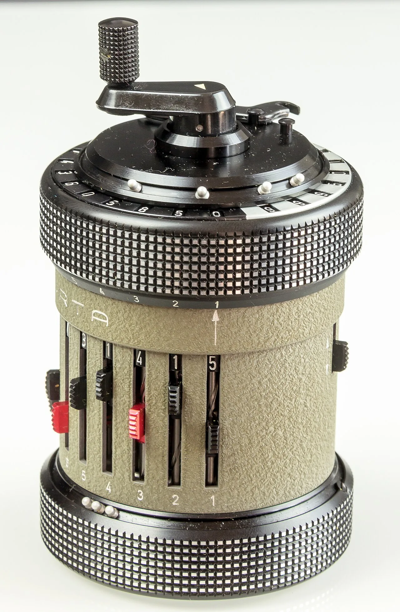](curta-ii-1126.webp)

Curta II. Photo: Raimond Spekking, [CC BY-SA 4.0](https://creativecommons.org/licenses/by-sa/4.0), via [Wikimedia Commons](https://commons.wikimedia.org/wiki/File:Curta_II-1126.jpg).

[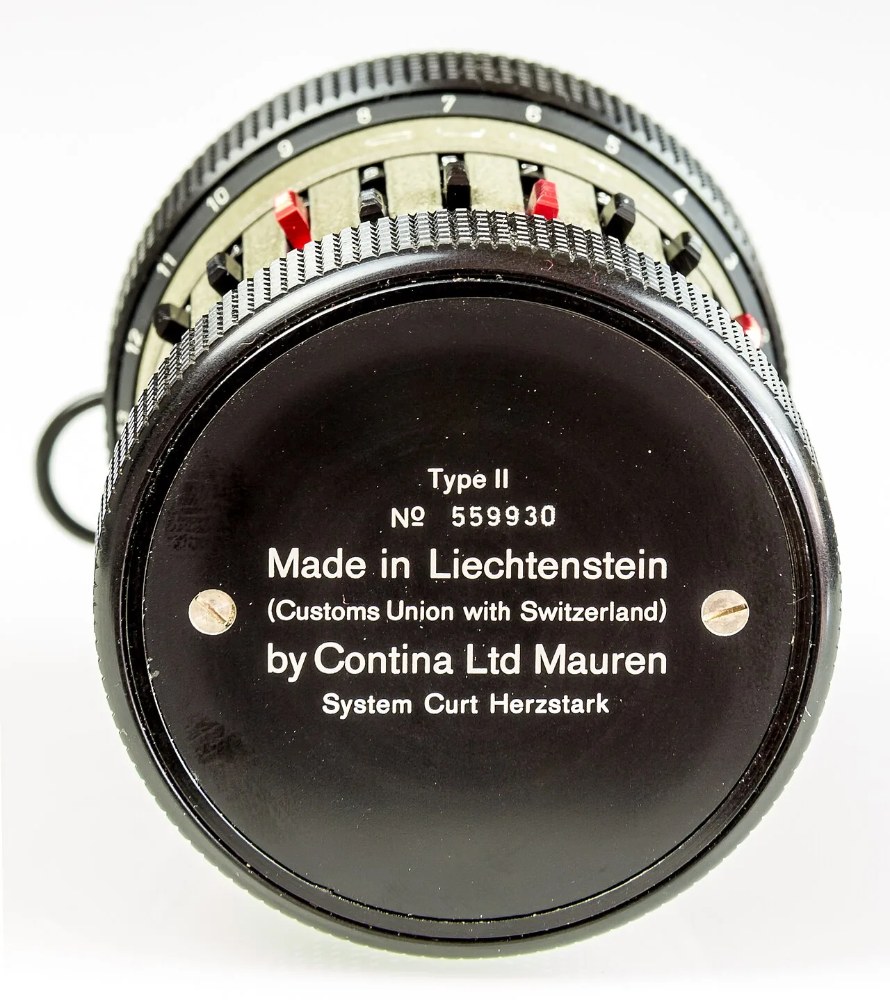](curta-ii-1127.webp)

Curta II. Photo: Raimond Spekking, [CC BY-SA 4.0](https://creativecommons.org/licenses/by-sa/4.0), via [Wikimedia Commons](https://commons.wikimedia.org/wiki/File:Curta_II-1127.jpg).

[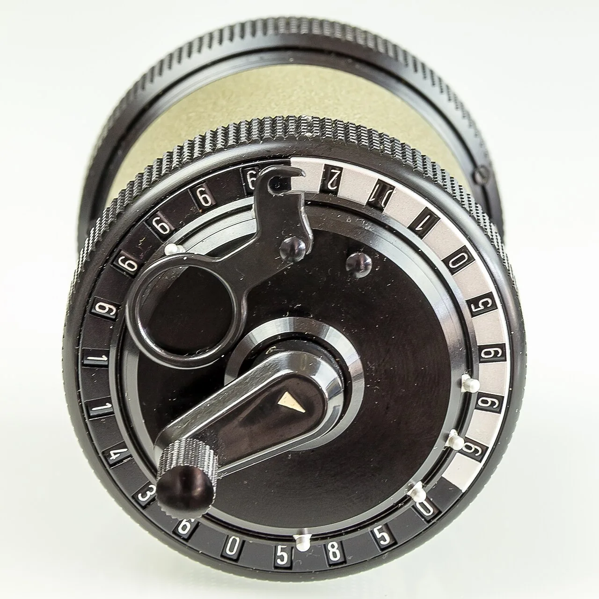](curta-ii-1128.webp)

Curta II. Photo: Raimond Spekking, [CC BY-SA 4.0](https://creativecommons.org/licenses/by-sa/4.0), via [Wikimedia Commons](https://commons.wikimedia.org/wiki/File:Curta_II-1128.jpg).

[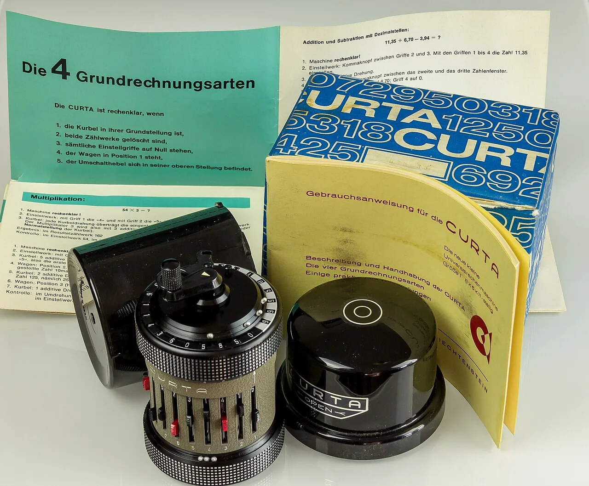](curta-ii-1129.webp)

Curta II. Photo: Raimond Spekking, [CC BY-SA 4.0](https://creativecommons.org/licenses/by-sa/4.0), via [Wikimedia Commons](https://commons.wikimedia.org/wiki/File:Curta_II-1129.jpg).

[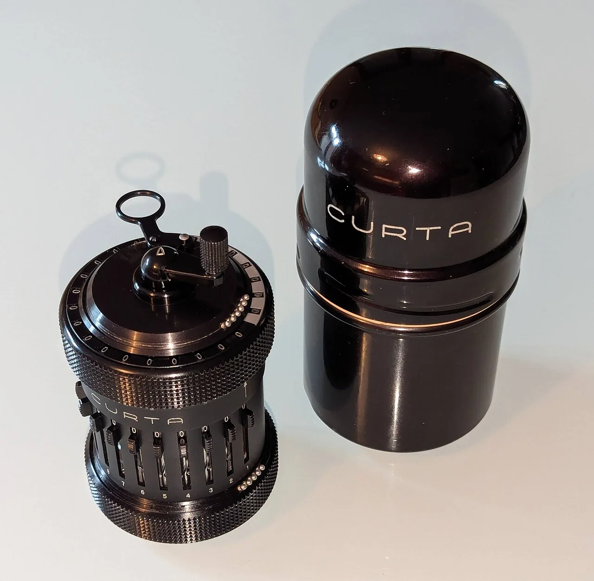](curta-type-2-ancienne-couleur.webp)

An early black Curta Type II and its case. Photo: Manuco, [CC BY 4.0](https://creativecommons.org/licenses/by/4.0), via [Wikimedia Commons](https://commons.wikimedia.org/wiki/File:Curta_type_2_ancienne_couleur.jpg).

[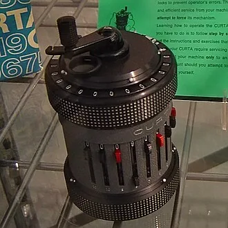](curta-type-ii.webp)

Curta Type II at the Computer History Museum, Mountain View. Photo: Calton, [CC BY-SA 3.0](http://creativecommons.org/licenses/by-sa/3.0/), via [Wikimedia Commons](https://commons.wikimedia.org/wiki/File:Curta_Type_II.jpg).

[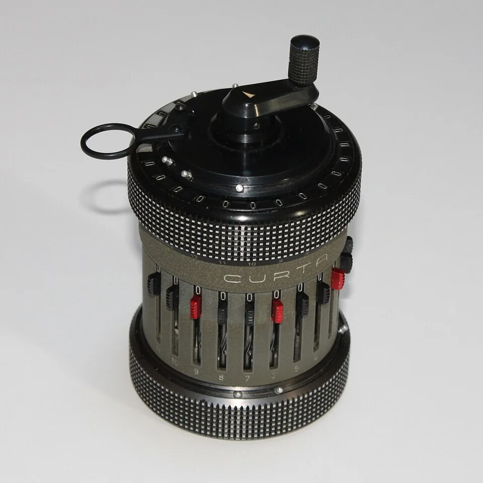](curta-80.webp)

Curta Type II mechanical calculator. Photo: Nol Aders, [CC BY-SA 3.0](https://creativecommons.org/licenses/by-sa/3.0), via [Wikimedia Commons](https://commons.wikimedia.org/wiki/File:Curta-80.jpg).

[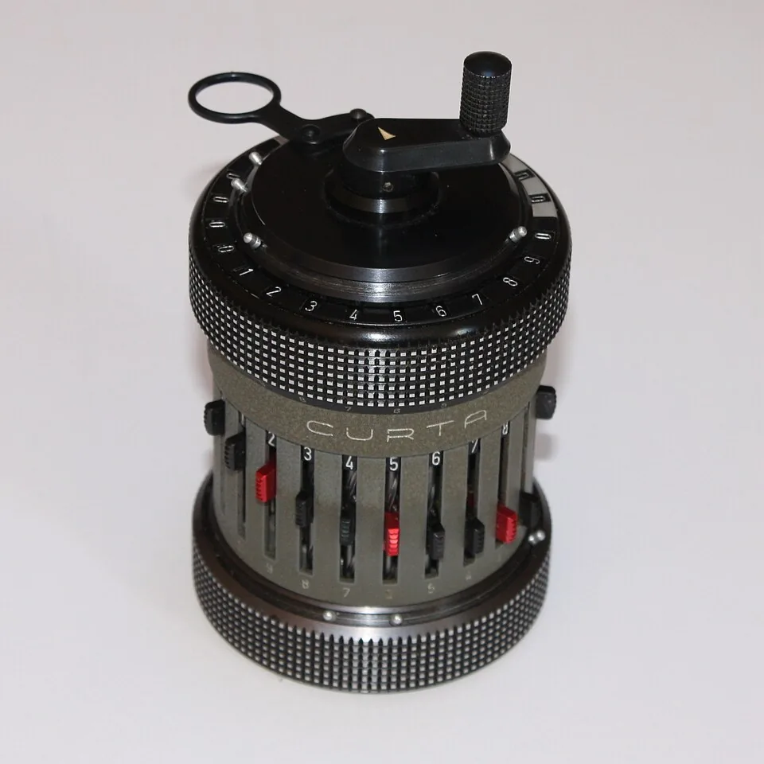](curta-93.webp)

Curta Type II mechanical calculator. Photo: Nol Aders, [CC BY-SA 3.0](https://creativecommons.org/licenses/by-sa/3.0), via [Wikimedia Commons](https://commons.wikimedia.org/wiki/File:Curta-93.jpg).

[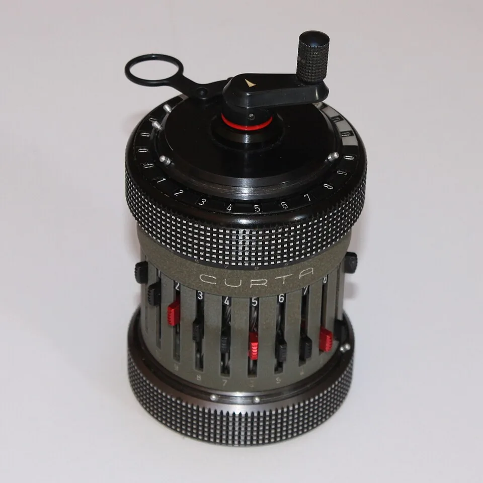](curta-95.webp)

Curta Type II with the crank pulled up to subtract. Photo: Nol Aders, [CC BY-SA 3.0](https://creativecommons.org/licenses/by-sa/3.0), via [Wikimedia Commons](https://commons.wikimedia.org/wiki/File:Curta-95.jpg).

[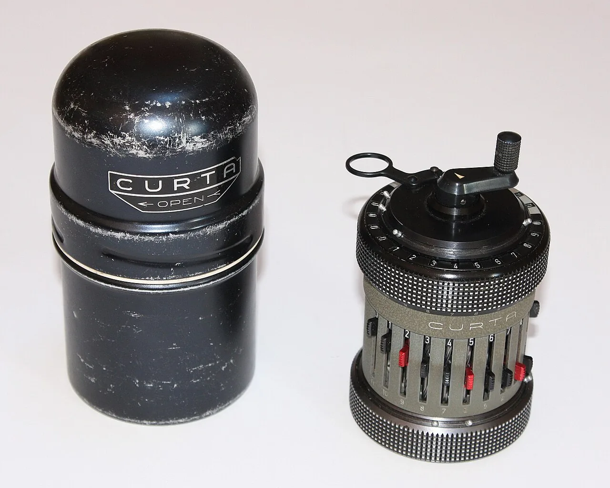](curta-99.webp)

Curta Type II mechanical calculator. Photo: Nol Aders, [CC BY-SA 3.0](https://creativecommons.org/licenses/by-sa/3.0), via [Wikimedia Commons](https://commons.wikimedia.org/wiki/File:Curta-99.jpg).

[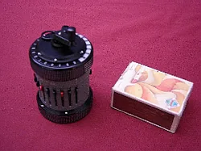](curta1.webp)

A Curta beside a matchbox, for scale. Photo: Ratigan at French Wikipedia, [CC BY-SA 3.0](http://creativecommons.org/licenses/by-sa/3.0/), via [Wikimedia Commons](https://commons.wikimedia.org/wiki/File:Curta1.png).

[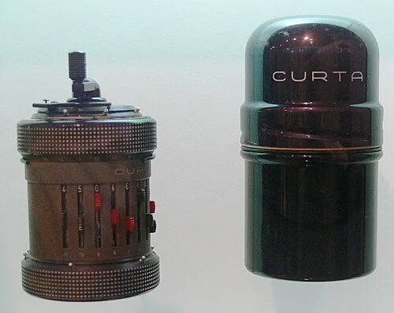](handrechenmaschine-curta-ii-dzm.webp)

Curta Type II Nº 511265, used by the German federal customs service 1950s–1970s; Deutsches Zollmuseum, Hamburg. Photo: Andreas Praefcke, Public domain, via [Wikimedia Commons](https://commons.wikimedia.org/wiki/File:Handrechenmaschine_Curta_II_DZM.jpg).

[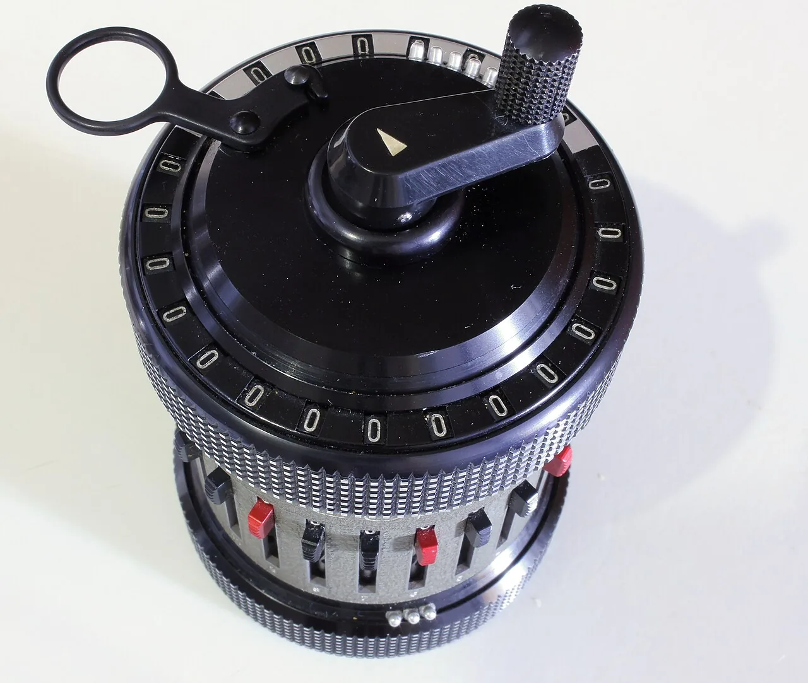](mechanicky-kalkulator-curta-ii.webp)

Curta Type II. Photo: Oldsoft, [CC BY-SA 4.0](https://creativecommons.org/licenses/by-sa/4.0), via [Wikimedia Commons](https://commons.wikimedia.org/wiki/File:Mechanick%C3%BD_kalkul%C3%A1tor_Curta_II.JPG).

[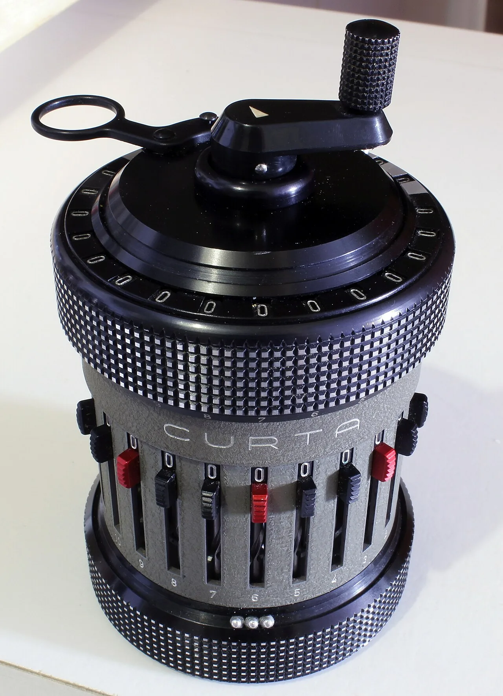](mechanicky-kalkulator-curta-typ-ii.webp)

Curta Type II. Photo: Oldsoft, [CC BY-SA 4.0](https://creativecommons.org/licenses/by-sa/4.0), via [Wikimedia Commons](https://commons.wikimedia.org/wiki/File:Mechanick%C3%BD_kalkul%C3%A1tor_Curta,_typ_II.JPG).

[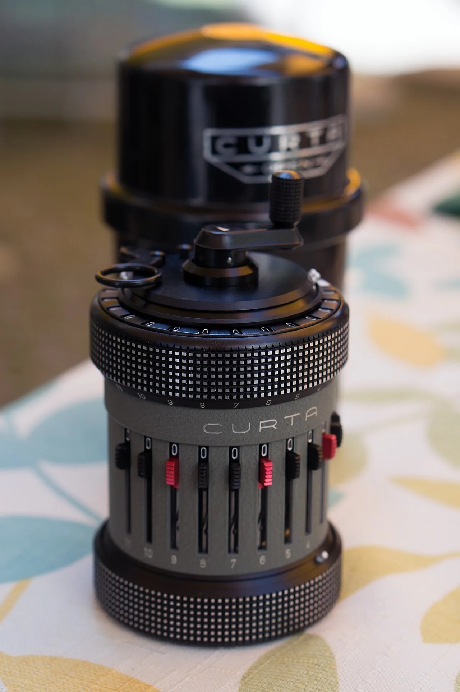](type-ii-curta.webp)

Type II Curta. Photo: Wekratz, [CC BY-SA 3.0](https://creativecommons.org/licenses/by-sa/3.0), via [Wikimedia Commons](https://commons.wikimedia.org/wiki/File:Type_II_Curta.jpg).

## Inside the Curta

[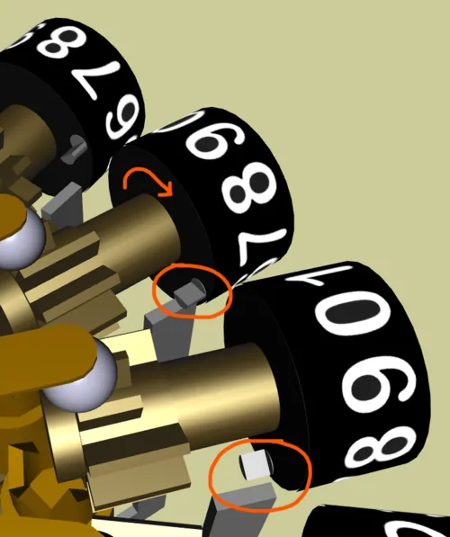](carry-lever-actuation.webp)

Inside: the small pins on the counting wheels that press the carry levers as a wheel passes from 9 to 0. Photo: Manuco, [CC0](http://creativecommons.org/publicdomain/zero/1.0/deed.en), via [Wikimedia Commons](https://commons.wikimedia.org/wiki/File:Carry_lever_actuation.png).

[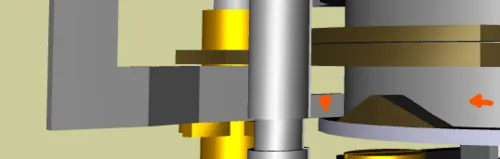](carry-lever-reset-cam.webp)

Inside: the cam that lifts each carry lever back to its resting (up) position. Photo: Manuco, [CC0](http://creativecommons.org/publicdomain/zero/1.0/deed.en), via [Wikimedia Commons](https://commons.wikimedia.org/wiki/File:Carry_lever_reset_cam.png).

Inside: top of a carry lever at rest (up), with its pin on the left. Photo: Manuco, [CC0](http://creativecommons.org/publicdomain/zero/1.0/deed.en), via [Wikimedia Commons](https://commons.wikimedia.org/wiki/File:Carry_lever_up_position_with_0_digit_displayed.png).

[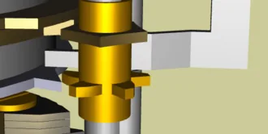](carry-lever-with-engaged-gear.webp)

Inside: underside of a carry lever riding its cam and pushing the sliding gear down to meet the carry tooth. Photo: Manuco, [CC0](http://creativecommons.org/publicdomain/zero/1.0/deed.en), via [Wikimedia Commons](https://commons.wikimedia.org/wiki/File:Carry_lever_with_engaged_gear.png).

[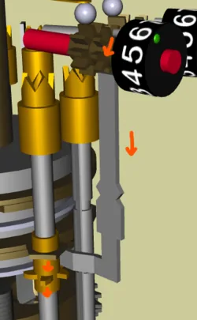](carry-propagation.webp)

Inside: a carry: the wheel's pin presses the carry lever, which drops the sliding gear into the path of the carry tooth. Photo: Manuco, [CC0](http://creativecommons.org/publicdomain/zero/1.0/deed.en), via [Wikimedia Commons](https://commons.wikimedia.org/wiki/File:Carry_propagation.png).

[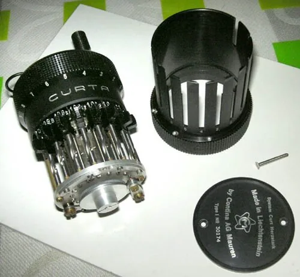](curtadsasm.webp)

A partly taken-apart Curta. Photo: Janke, Public domain, via [Wikimedia Commons](https://commons.wikimedia.org/wiki/File:Curtadsasm.JPG).

[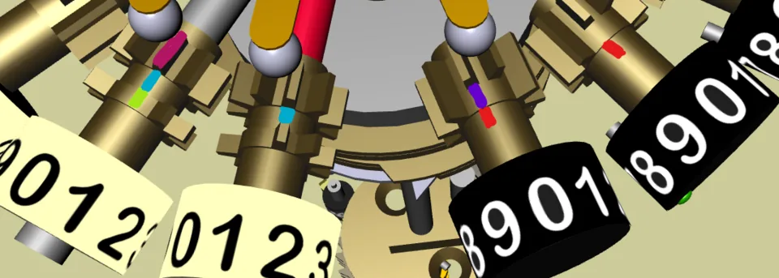](reset-details-with-zones.webp)

Inside: the clearing gears, by zone (pink: gears driven by the vertical transfer shafts; green and blue: the two clearing racks). Photo: Manuco, [CC0](http://creativecommons.org/publicdomain/zero/1.0/deed.en), via [Wikimedia Commons](https://commons.wikimedia.org/wiki/File:Reset_details_with_zones.png).

[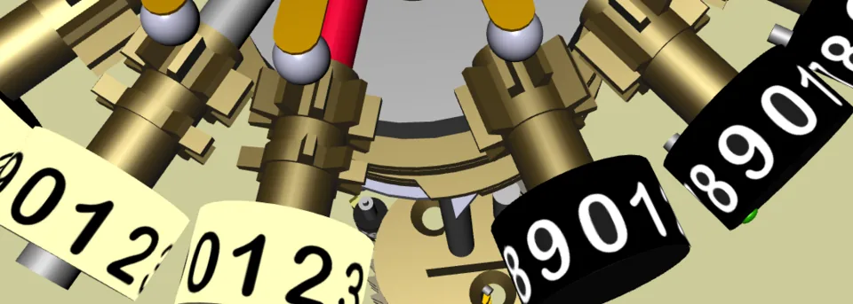](reset-details.webp)

Inside: the clearing (reset) gears. Photo: Manuco, [CC0](http://creativecommons.org/publicdomain/zero/1.0/deed.en), via [Wikimedia Commons](https://commons.wikimedia.org/wiki/File:Reset_details.png).

[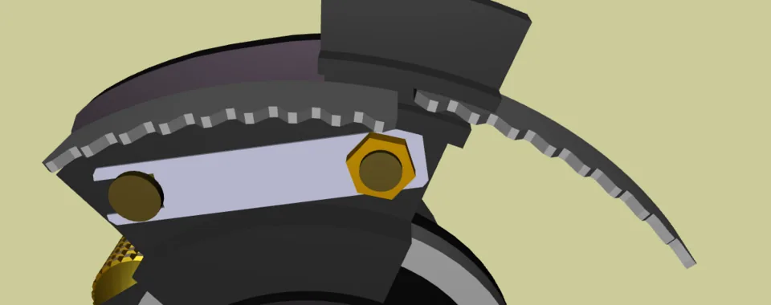](reset-rack.webp)

Inside: the two clearing racks; the left one zeroes the first two wheels of each register, the right one the rest. Photo: Manuco, [CC0](http://creativecommons.org/publicdomain/zero/1.0/deed.en), via [Wikimedia Commons](https://commons.wikimedia.org/wiki/File:Reset_rack.png).

[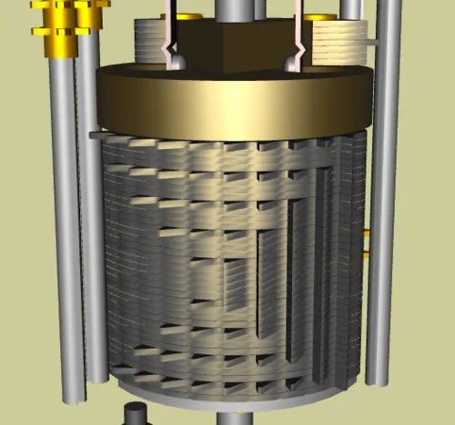](stepped-drum.webp)

Inside: the teeth of the stepped drum, with its two sets (adding, and nines-complement for subtracting) half a step apart. Photo: Manuco, [CC0](http://creativecommons.org/publicdomain/zero/1.0/deed.en), via [Wikimedia Commons](https://commons.wikimedia.org/wiki/File:Stepped_drum.png).

## History

[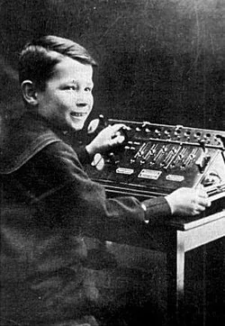](curt-1910-6a.webp)

Curt Herzstark, aged 8, demonstrating one of his father's calculating machines at an office-equipment show in Vienna, 1910. Photo: Unknown photographer, Public domain, via [Wikimedia Commons](https://commons.wikimedia.org/wiki/File:Curt-1910-6a.jpg).

[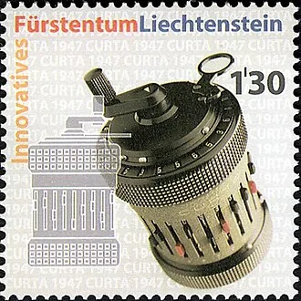](curta-calculator-2006-stamp-of-liechtenstein.webp)

Liechtenstein's 2006 stamp "Technical innovations from Liechtenstein: the Curta calculator". Photo: Liechtensteinische Post AG, Public domain, via [Wikimedia Commons](https://commons.wikimedia.org/wiki/File:Curta_calculator_2006_stamp_of_Liechtenstein.jpg).

## More Curtas, in museums and in hand

[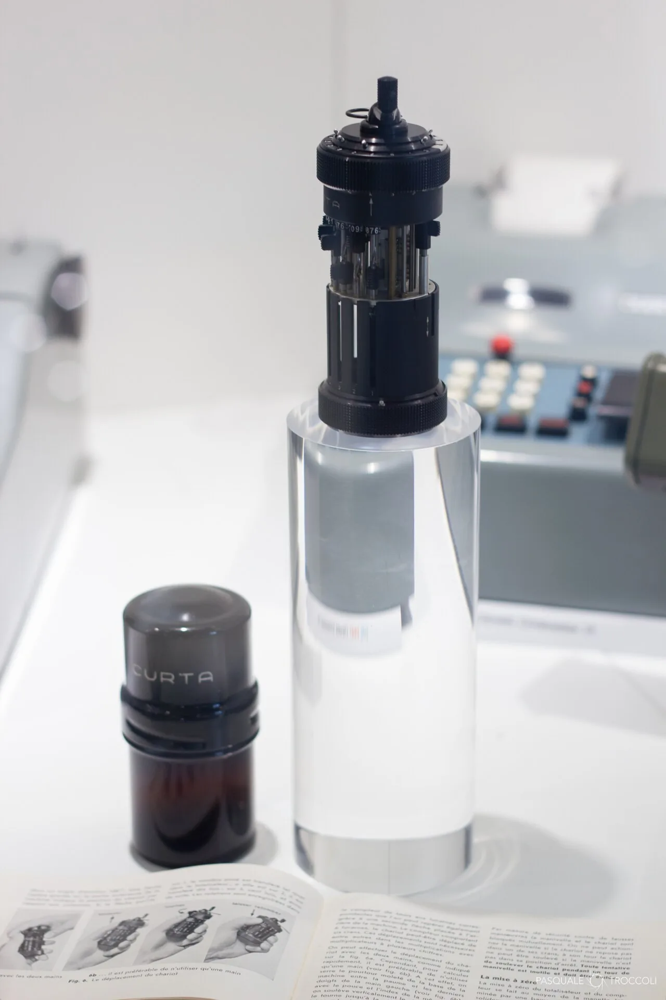](calcolatrice-meccanica-curta.webp)

A Curta. Photo: Pasquale Troccoli, [CC BY-SA 3.0](https://creativecommons.org/licenses/by-sa/3.0), via [Wikimedia Commons](https://commons.wikimedia.org/wiki/File:Calcolatrice_meccanica_Curta.jpg).

[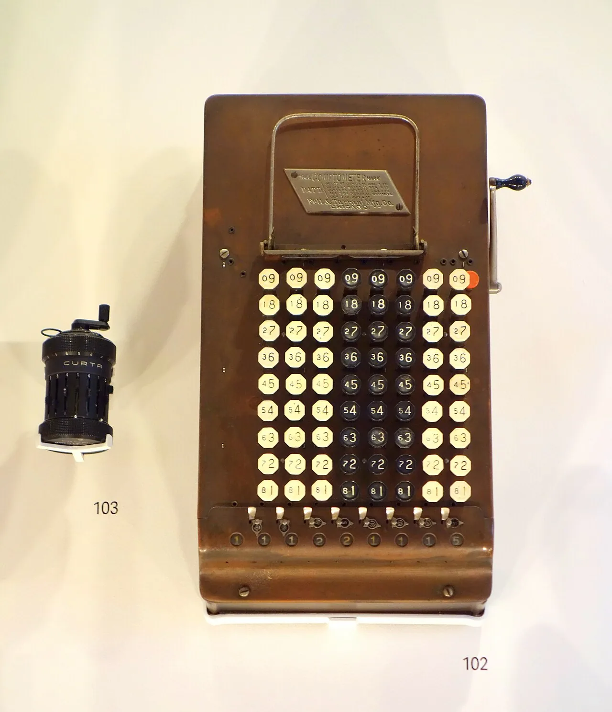](comptometer-calculating-machine-102-designed-and-made-by-fel.webp)

A Curta beside a 1915 Comptometer; Design Museum, London. Photo: Daderot, [CC0](http://creativecommons.org/publicdomain/zero/1.0/deed.en), via [Wikimedia Commons](https://commons.wikimedia.org/wiki/File:Comptometer_calculating_machine_(102),_designed_and_made_by_Felt_%26_Tarrant,_1915,_and_Curta_calculator_(103),_designed_by_Curt_Herzstark,_made_by_Contina_AG_Mauren,_1947_-_Design_Museum,_Kensington_-_DSC01638.jpg).

Curta hand calculator. Photo: Bubba73, [CC BY-SA 3.0](https://creativecommons.org/licenses/by-sa/3.0), via [Wikimedia Commons](https://commons.wikimedia.org/wiki/File:Computer_Museum_of_America_(03).jpg).

A Curta. Photo: Marcin Wichary from San Francisco, U.S.A., [CC BY 2.0](https://creativecommons.org/licenses/by/2.0), via [Wikimedia Commons](https://commons.wikimedia.org/wiki/File:Curta_(2224521929).jpg).

Curta Calculator, 1950-1960s, Computer History Museum. Photo: The wub, [CC BY-SA 4.0](https://creativecommons.org/licenses/by-sa/4.0), via [Wikimedia Commons](https://commons.wikimedia.org/wiki/File:Curta_Calculator,_1950-1960s,_Computer_History_Museum.jpg).

Curtas at the Ridai Museum of Modern Science, Tokyo University of Science. Photo: Daderot, [CC0](http://creativecommons.org/publicdomain/zero/1.0/deed.en), via [Wikimedia Commons](https://commons.wikimedia.org/wiki/File:Curta_calculators_-_Ridai_Museum_of_Modern_Science,_Tokyo_-_DSC07524.JPG).

Curta Mechanical Calculator at CHM. Photo: Don DeBold from San Jose, CA, USA, [CC BY 2.0](https://creativecommons.org/licenses/by/2.0), via [Wikimedia Commons](https://commons.wikimedia.org/wiki/File:Curta_Mechanical_Calculator_at_CHM_(7995215541).jpg).

A Curta; Musée d'histoire des sciences, Geneva (MHS 2443). Photo: Rama, [CC BY-SA 3.0 fr](https://creativecommons.org/licenses/by-sa/3.0/fr/deed.en), via [Wikimedia Commons](https://commons.wikimedia.org/wiki/File:Curta_mechanical_computer-MHS_2443-IMG_9923.JPG).

A Curta; Musée d'histoire des sciences, Geneva (MHS 2443). Photo: Rama, [CC BY-SA 3.0 fr](https://creativecommons.org/licenses/by-sa/3.0/fr/deed.en), via [Wikimedia Commons](https://commons.wikimedia.org/wiki/File:Curta_mechanical_computer-MHS_2443-IMG_9924.JPG).

Curtas from the Peter Regenass collection, Museum Enter, Solothurn. Photo: Dominik Landwehr, [CC BY-SA 4.0](https://creativecommons.org/licenses/by-sa/4.0), via [Wikimedia Commons](https://commons.wikimedia.org/wiki/File:Curta_Rechenmaschinen_im_Museum_Enter_Solothurn.jpg).

A Curta. Photo: Badbutcherbg, [CC BY-SA 4.0](https://creativecommons.org/licenses/by-sa/4.0), via [Wikimedia Commons](https://commons.wikimedia.org/wiki/File:Curta.png).

A large wooden model of the Curta, Museum Enter, Solothurn. Photo: Dominik Landwehr, [CC BY-SA 4.0](https://creativecommons.org/licenses/by-sa/4.0), via [Wikimedia Commons](https://commons.wikimedia.org/wiki/File:Holzmodell_Curta_Rechenmaschine.jpg).

Curtas at Museum Enter, Solothurn. Photo: Bobo11, [CC BY-SA 3.0](https://creativecommons.org/licenses/by-sa/3.0), via [Wikimedia Commons](https://commons.wikimedia.org/wiki/File:Museum-Enter-6095023.JPG).

A Curta. Photo: Miloš Jurišić, [CC BY-SA 3.0](https://creativecommons.org/licenses/by-sa/3.0), via [Wikimedia Commons](https://commons.wikimedia.org/wiki/File:Ra%C4%8Dunarska_ma%C5%A1ina_CURTA.jpg).

A Type II and a Type I side by side. Photo: Werner Kratz from Switzerland, [CC BY 2.0](https://creativecommons.org/licenses/by/2.0), via [Wikimedia Commons](https://commons.wikimedia.org/wiki/File:Type_II_and_Type_I_Curta_(9064000240).jpg).
